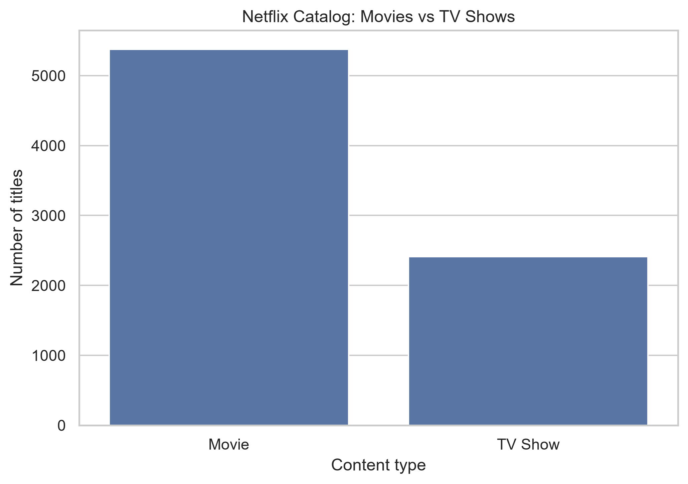
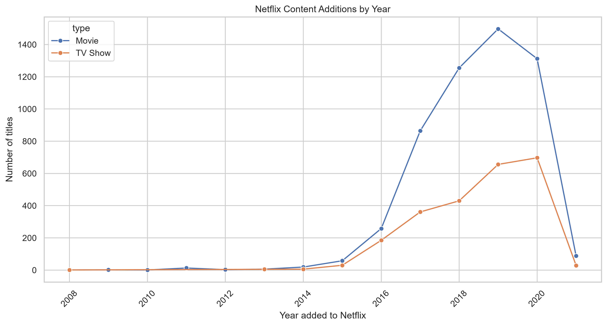
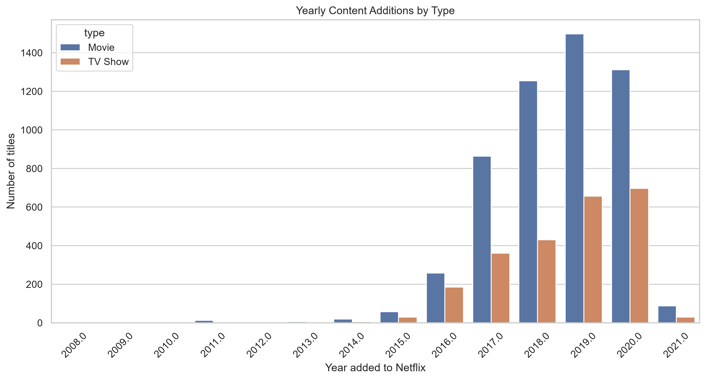
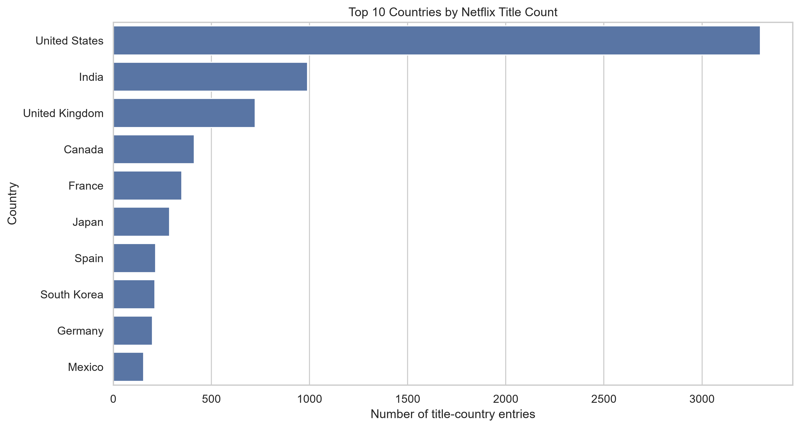
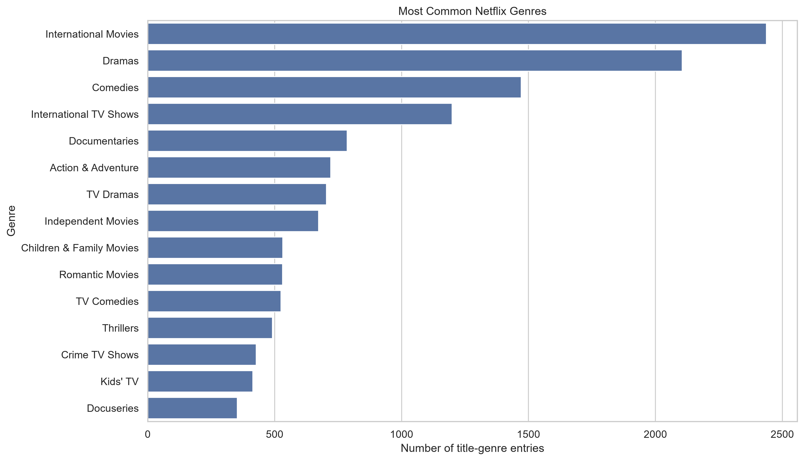
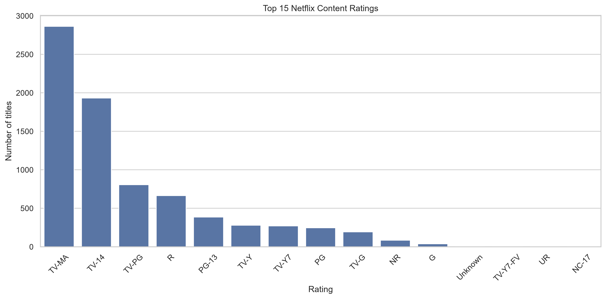
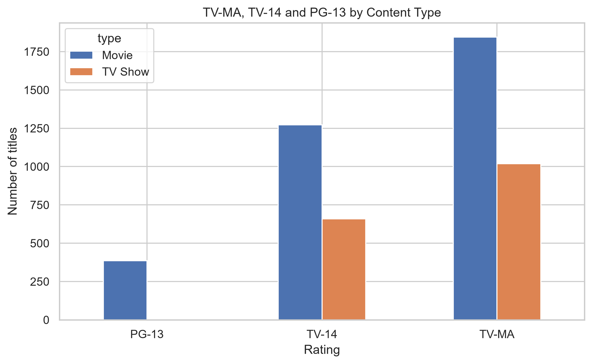

# Internship Project Report
## Exploratory Data Analysis of Netflix Movies and TV Shows

**Internship domain:** Python / Data Analytics  
**Project title:** Exploratory Data Analysis of Netflix Movies and TV Shows  
**Candidate:** Ahamed Nafil A  
**Organization:** Spark Tech 
**Internship duration:** 21/09/2026 to 04/11/2026  
**Tools:** Python, Pandas, NumPy, Seaborn, Matplotlib, WordCloud

---

## 1. Abstract
This project performs exploratory data analysis (EDA) on a public dataset containing information about Netflix movies and television shows. Python libraries are used to inspect, clean, transform and summarize the data. Visualizations are created to examine the balance between movies and TV shows, catalogue additions over time, country and genre representation, and content-rating patterns. The analysis demonstrates a reproducible data-analysis workflow, from loading raw CSV data to producing charts and summary tables.

## 2. Introduction
Streaming platforms provide large catalogues of films and television programmes. Analysing catalogue metadata can help describe the composition and variety of available content. EDA uses descriptive statistics and visual methods to understand data quality, distributions, patterns and relationships before more advanced analysis.

## 3. Project objectives
- Load and inspect the Netflix titles dataset using Pandas.
- Identify missing values and prepare data for analysis.
- Compare the number and percentage of movies and TV shows.
- Examine yearly content additions.
- Identify countries and genres appearing most frequently.
- Explore rating distributions and compare selected ratings by content type.
- Present findings through clear visualizations.

## 4. Dataset description
The CSV dataset contains title-level metadata. Common fields include `show_id`, `type`, `title`, `director`, `cast`, `country`, `date_added`, `release_year`, `rating`, `duration`, `listed_in` and `description`. The dataset is a historical snapshot and should not be treated as a live catalogue.

## 5. Tools and technologies
- **Python:** General-purpose programming language used to implement the analysis.
- **Pandas:** CSV loading, data cleaning, grouping and tabular summaries.
- **NumPy:** Numerical summary calculations.
- **Seaborn:** Statistical charts.
- **Matplotlib:** Plot creation and saving.
- **WordCloud:** Visualization of frequent terms in descriptions.

## 6. Methodology
### 6.1 Data loading and inspection
The dataset is loaded with `pd.read_csv()`. `head()`, `info()` and `isnull().sum()` are used to inspect records, column types and missing values.

### 6.2 Data cleaning
Duplicate records are removed. Missing director, cast, country, rating, duration, genre and description values are represented as `Unknown` for categorical/text analysis. The `date_added` field is converted using `pd.to_datetime(errors='coerce')`. Missing or invalid dates remain `NaT`; no dates are fabricated.

### 6.3 Content type analysis
`value_counts()` calculates Movie and TV Show counts. Percentages are calculated relative to the total number of records and saved in `content_type_summary.csv`.

### 6.4 Yearly additions
The year is extracted from `date_added`. Grouping by year and content type provides the yearly addition counts, displayed with line and bar charts.

### 6.5 Country analysis
Comma-separated country names are split and expanded into individual rows using `explode()`. The ten most frequent country entries are displayed in a horizontal bar chart.

### 6.6 Genre analysis
The `listed_in` field is split and exploded to count individual genre mentions. The most frequent genres are saved and visualized.

### 6.7 Description WordCloud
Description text is combined and passed to WordCloud to display frequently occurring terms. This is a qualitative text visualization; frequent words do not automatically indicate audience popularity.

### 6.8 Rating analysis
Rating frequencies are calculated and plotted. A cross-tabulation compares TV-MA, TV-14 and PG-13 across Movie and TV Show records. Some rating labels are more commonly associated with one content type, so interpretation should consider the actual data counts.

## 7. Implementation
The complete implementation is provided in `src/netflix_eda.py`. Run it from the project root:
```bash
python src/netflix_eda.py
```
The input CSV must be stored at `data/netflix_titles.csv`.

## 8. Results and visualizations
After running the program, insert the generated charts from `outputs/charts/` and describe the actual results:
- `01_content_type_distribution.png` — movie and TV show comparison.
- `02_yearly_additions_line.png` — yearly addition trend.
- `03_yearly_additions_bar.png` — yearly additions by content type.
- `04_top_10_countries.png` — leading country entries.
- `05_top_genres.png` — most frequent genre entries.
- `06_description_wordcloud.png` — frequent description terms.
- `07_rating_distribution.png` — most common ratings.
- `08_selected_ratings_by_type.png` — selected ratings by content type.

Use the CSV files in `outputs/` to report exact counts and percentages. Do not fill this section with guessed values.

The analysis was performed on the Netflix dataset after removing duplicate records.

The following results were obtained:

- Total records after duplicate removal: 7,787
- Total Movies: 5,377 (69.05%)
- Total TV Shows: 2,410 (30.95%)
- Records with missing date_added: 10
- Average release year: 2013.93
- Median release year: 2017

The results indicate that Movies represent the larger share of titles in the dataset.

### 8.1 Content Type Distribution


### 8.2 Yearly Additions


### 8.3 Yearly Additions by Type


### 8.4 Top Countries


### 8.5 Top Genres


### 8.6 Description WordCloud


### 8.7 Rating Distribution


### 8.8 Selected Ratings by Type


## 9. Key observations
1. Movies account for the largest share of the Netflix catalogue, with 5,377 titles compared to 2,410 TV Shows.
2. The average release year is approximately 2014, while the median release year is 2017.
3. The dataset contains 10 records with missing date-added information.
4. The most frequently listed countries and genres can be identified using the generated summary tables.
5. Rating distributions show how content ratings are represented across Movies and TV Shows.
6. Duplicate records and missing metadata are important data-quality limitations considered during analysis.

## 10. Limitations
- The dataset is a historical snapshot and does not represent the current Netflix catalogue.
- The dataset contains metadata, not streaming views, watch time, revenue or user ratings.
- A title may be associated with multiple countries and genres.
- Missing metadata can affect country, director and rating summaries.
- WordCloud frequency is not a measure of title popularity.

## 11. Conclusion
This project demonstrates an end-to-end exploratory data analysis workflow using Python. It covers data inspection, missing-value handling, date conversion, multi-value column transformation, aggregation and visualization. The generated tables and charts provide a structured description of the Netflix titles dataset and demonstrate practical use of common Python data-analysis libraries.

## 12. Future enhancements
- Add interactive filters using Plotly or Streamlit.
- Compare movie duration and TV-show season counts.
- Perform sentiment or keyword analysis on descriptions.
- Add a dashboard with downloadable filtered summaries.
- Refresh the analysis with a newer, appropriately licensed dataset.

## 13. References
- Dataset: TidyTuesday, Netflix titles dataset (2021-04-20): https://github.com/rfordatascience/tidytuesday/tree/main/data/2021/2021-04-20
- Pandas documentation: https://pandas.pydata.org/docs/
- NumPy documentation: https://numpy.org/doc/
- Seaborn documentation: https://seaborn.pydata.org/
- Matplotlib documentation: https://matplotlib.org/stable/
- WordCloud documentation: https://amueller.github.io/word_cloud/
